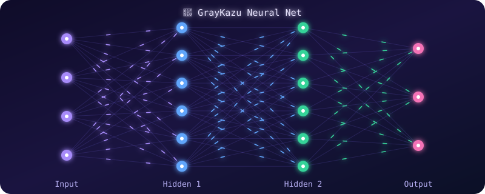

  

## 👋 Xin chào, tui là **GrayKazu**

Tui hay mày mò **phần cứng + firmware**: bắt màn hình Casio "fake" lên hình, viết cả IDE tiếng Việt cho vui 😎

## 🧠 Mạng nơ-ron AI

## 🚀 Dự án

<table>
<tr>
<td width="50%" valign="top">

### 💜 GKcode 4.4
IDE cho **Python / ESP / Arduino**, giao diện **tiếng Việt**, bấm **F5 là chạy**.

</td>
<td width="50%" valign="top">

### ⚡ KazuOS 1.4.1
Mini OS cho **ESP32**, chạy trên màn Casio LCD.

</td>
</tr>
<tr>
<td width="50%" valign="top">

### 📟 CasioST75256
Driver **ST75256** cho màn **192x63** của Casio fx-880BTG (fake). Thư viện giúp khởi chạy màn hình lên hình.

</td>
<td width="50%" valign="top">

### 🎨 GrayKazu (icon lib)
Thư viện chứa **vô vàn icon đẹp mắt** cho các dự án Arduino của bạn!

</td>
</tr>
</table>

### 📌 Repo nổi bật

## 🧰 Tech stack

## 📊 Stats

 

 

## 📬 Liên hệ

**✈️ Made with 💜 by GrayKazu vn ✈️**

